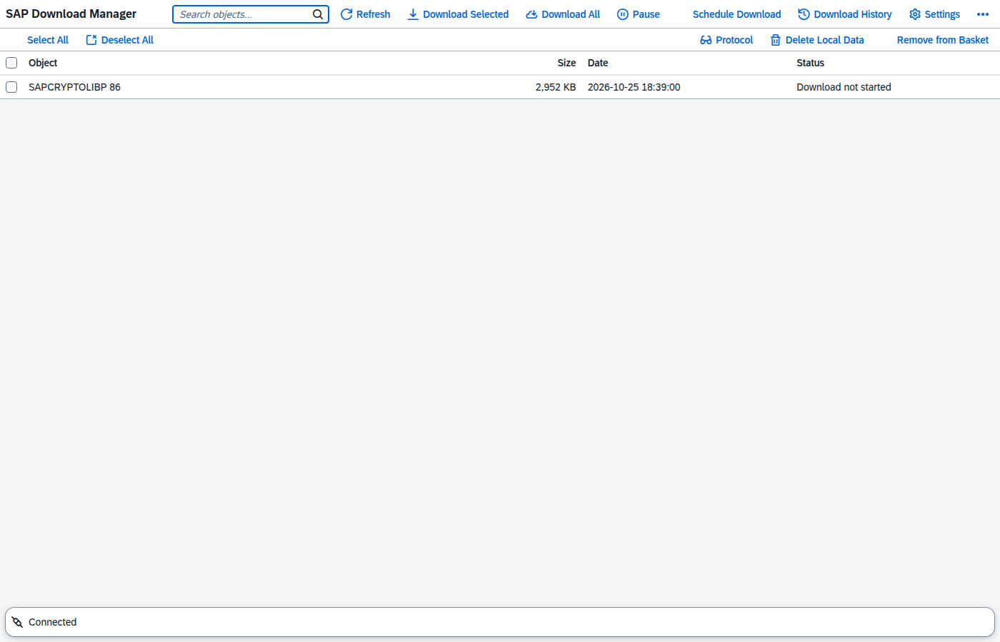
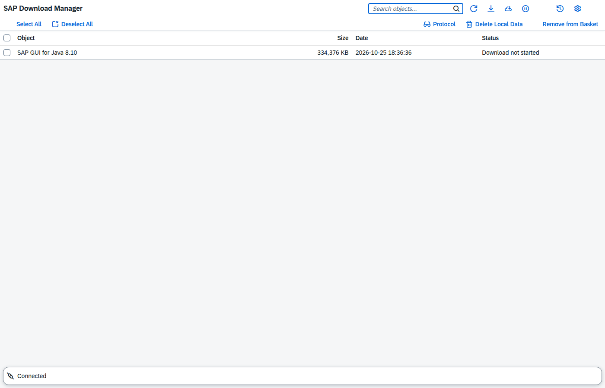
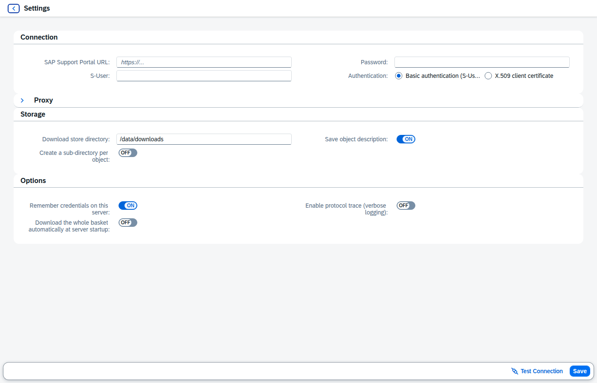
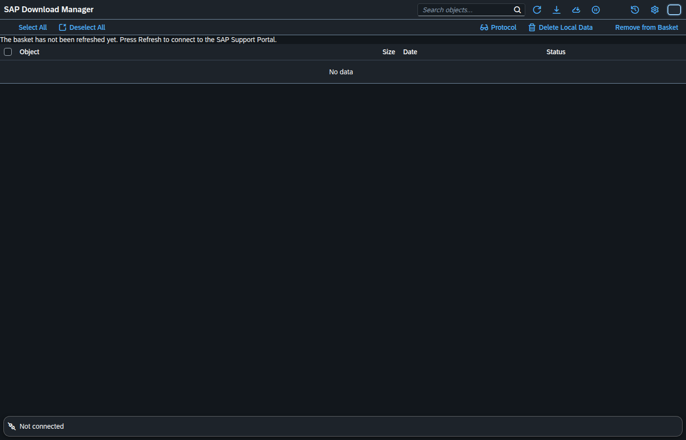

# SAP Web Download Manager

A web-based reimplementation of the official **SAP Download Manager** — the
Java desktop tool that downloads your [SAP Support Portal download
basket](https://support.sap.com/en/my-support/software-downloads.html?isu_page=1&anchorId=section_995042677)
to your machine. This fork keeps the protocol and features of the original,
but replaces the desktop GUI with a modern web UI and runs as a containerized
server: operate it from any browser, files land on the server.

**Original:** [SAP Download Manager (official, Java)](https://support.sap.com/en/my-support/software-downloads.html?isu_page=1&anchorId=section_995042677)



## Highlights

- Same wire protocol as the official client (Support Portal OData and legacy
  Service Marketplace) — your S-User and password just work
- Resumable downloads with crash-safe checkpoints; pause/resume/cancel
- Scheduled and fully automatic (startup) downloads
- S-User/password or X.509 client certificate; optional proxy
- Fiori-style OpenUI5 UI, light and dark theme, live progress over WebSocket
- REST API + MCP server for AI-agent remote control
- Ships as a Docker image — headless server, internal plain HTTP

## Quickstart

```bash
mkdir -p data downloads     # host dirs must be owned by uid 1000
docker compose up --build   # open http://localhost:8000/ui/
```

The first start opens a wizard asking for your S-User and password (URL and
download directory are prefilled). Fill your basket in the
[Software Download Center](https://support.sap.com/swdc), press *Refresh*,
and download.

One-shot download of the whole basket (e.g. via cron):

```bash
docker compose run --rm sapdlm python -m sapdlm.main --auto
```

## Documentation

- **[How it works](docs/HOWITWORKS.md)** — architecture, download engine,
  configuration, credentials, API/MCP reference, security model, Docker notes
- **[Protocol reference](docs/PROTOCOL.md)** — the wire protocol of the
  official Download Manager, reverse engineered and documented
- **[Development](docs/DEVELOPMENT.md)** — venv setup, tests, lint, tooling

## Screenshots

| | |
|---|---|
|  |  |
|  | |

## Notes

- This is an unofficial community project, not affiliated with or endorsed by
  SAP SE. "SAP" is a trademark of SAP SE; use of SAP services requires your own
  credentials and is subject to SAP's terms of use.
- The basket is filled on the Software Download Center website; this tool
  reads and downloads it (adding items is not part of the original client's
  protocol).
- The vendored OpenUI5 runtime is ~133 MB — clones are correspondingly sized.
